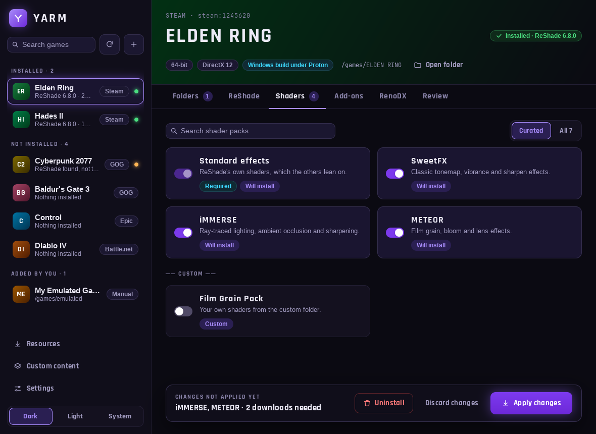

# YARM - Yet Another ReShade Manager

[](https://github.com/secato/yarm/actions/workflows/ci.yml)
[](https://github.com/secato/yarm/releases)
[](LICENSE)

**Put ReShade into your games, and take it back out.**

Pick a game, tick the ReShade version, shader packs and add-ons you want, and see what will
happen before it does. YARM writes it into the game folder, remembers every file, and
uninstalling gives the folder back exactly as it was.



It finds your Steam, GOG, Epic and Battle.net games, picks the right ReShade build and proxy DLL
from the game's executable, and offers the RenoDX HDR mod by name. It follows your desktop's dark
or light setting (and the Omarchy theme). The Dark / Light / System switch at the bottom of the
sidebar picks one (`YARM_THEME=dark` or `light` forces it too).

<details><summary>Light look</summary>


</details>

## Install

```sh
curl -fsSL https://raw.githubusercontent.com/secato/yarm/main/install.sh | sh
```

Downloads the latest release for your CPU, checks its checksum, and adds YARM to your
application menu. `./install.sh --uninstall` removes it again.

## Build it yourself

```sh
go build -o yarm ./cmd/yarm
./yarm
```

Needs Go 1.27+ and Linux (glibc). Nothing is written to a game folder until you press Install or
Apply changes, and anything YARM replaces is backed up first.

- **Review** lists what will be downloaded, written and replaced, including a file already in the way.
- **Uninstall** removes only what YARM wrote, and only if it is unchanged.
- **Adopts** a ReShade you installed by hand, so YARM can update or remove it.
- **Your own shaders and add-ons** go in `~/.local/share/yarm/custom/`.

MIT licensed: copy it, change it, do what you like. Built with [MyGo](https://github.com/egoist/mygo).
Working on it with an AI agent? Start at [CLAUDE.md](CLAUDE.md). How it works:
[docs/architecture](docs/architecture/README.md).

Credits: [ReShade](https://reshade.me/) by crosire; catalogs from
[reshade-shaders](https://github.com/crosire/reshade-shaders); inspired by
[LeShade](https://github.com/Ishidawg/LeShade) and
[reshade-steam-proton](https://github.com/kevinlekiller/reshade-steam-proton).
