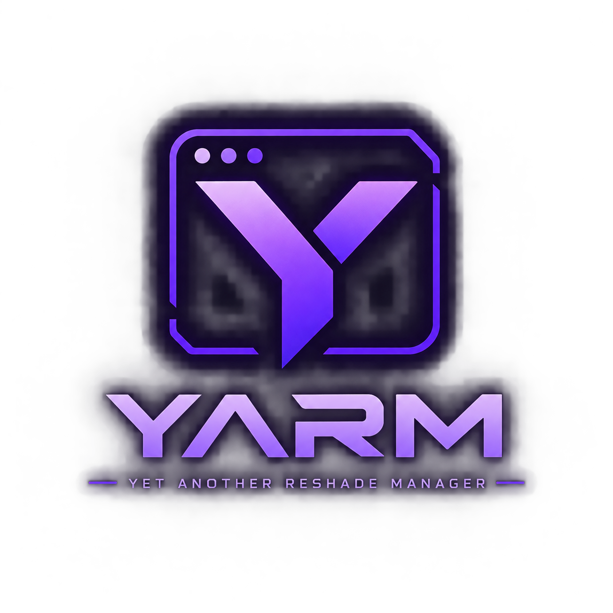
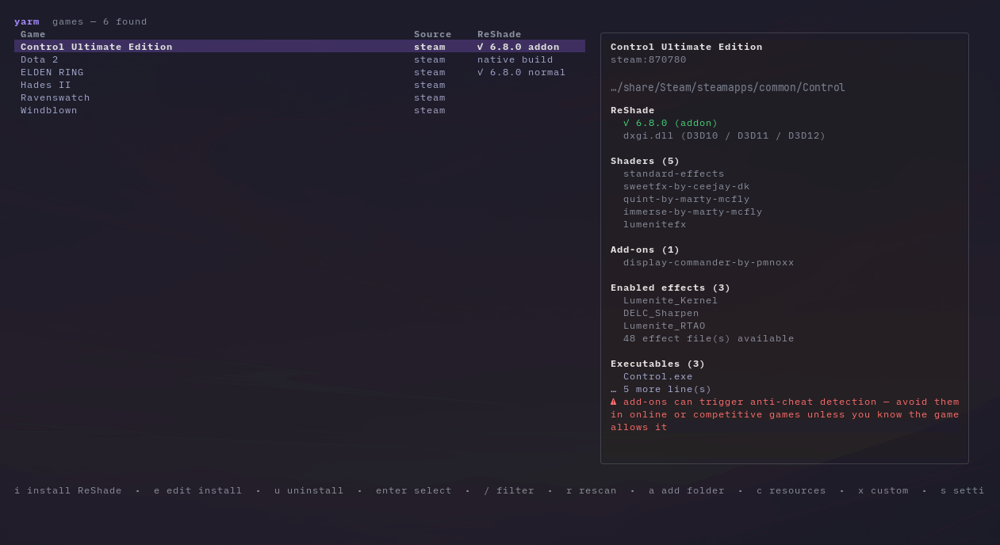

<div align="center">



# Yet Another ReShade Manager


[](https://github.com/secato/yarm/actions/workflows/ci.yml)
[](https://github.com/secato/yarm/releases)
[](https://goreportcard.com/report/github.com/secato/yarm)
[](LICENSE)

</div>

YARM finds your games, installs [ReShade](https://reshade.me/) into the ones you
choose along with the shaders and add-ons you want, and keeps track of every
file it put there — so uninstalling gives you the folder back exactly as it was.

It is a single binary with no runtime, no installer and no launcher running in
the background. It runs on **Windows and Linux**, including Steam Deck.

<div align="center">

</div><br/>

> Built with [Claude Code](https://claude.com/claude-code) — vibecoded, and
> tested like it wasn't. [Report what breaks.](https://github.com/secato/yarm/issues)


## What it does for you

- **Finds your games** — Steam, GOG, Epic and Battle.net (directly on Windows, through Heroic and Lutris on Linux), plus any folder you add by path.
- **Picks the right ReShade** — reads the game's executable for 32/64-bit and graphics API, and chooses the build and proxy DLL.
- **Curated shaders** — opens on the packs people actually use (SweetFX, iMMERSE, METEOR, …), with the full catalog one key away.
- **RenoDX HDR mods** — offers the right mod for your game by name.
- **Handles dependencies** — selecting an add-on also selects the shaders it needs, and says why.
- **Downloads once** — a shared cache, so the fifth game copies instead of re-downloading.
- **Uninstalls cleanly** — removes exactly the files it wrote and restores anything it replaced.
- **Warns before overwriting** — tells you up front when another injector holds ReShade's DLL slot.
- **Adopts manual installs** — takes over a ReShade you set up by hand.
- **Bring your own** — your own shaders and add-ons show up next to the catalog.

## Installing YARM

- **Linux:** `curl -fsSL https://raw.githubusercontent.com/secato/yarm/main/install.sh | sh` (run it again to update)
- **Windows:** download the zip from [Releases](https://github.com/secato/yarm/releases) and run `yarm.exe` in Windows Terminal.
- **From source:** `go install github.com/secato/yarm/cmd/yarm@latest`

Options, uninstalling and where yarm keeps its files: [docs/install.md](docs/install.md).

## Using it

Run `yarm`. Every screen lists its keys along the bottom and `?` opens the full
help, so there is nothing to memorise: arrows move, `enter` goes in, `esc` goes
back.

Nothing is written to a game folder until you confirm on the review page, which
shows what is already in the folder and what will happen to it, along with
anything still to download.

## Adding your own shaders and add-ons

Anything you put in yarm's `custom/` folder shows up in the wizard beside the
catalog packages:

```
custom/
├── shaders/<name>/Shaders/*.fx  Textures/*
└── addons/<name>/*.addon32|*.addon64
```

By default that is:

| OS | Folder |
| --- | --- |
| **Linux** | `~/.local/share/yarm/custom/` (or `$XDG_DATA_HOME/yarm/custom/`) |
| **Windows** | `%LOCALAPPDATA%\yarm\custom\` |

It lives with your data rather than in the cache, so clearing yarm's downloads
— or your `~/.cache` — never touches it. If you have set `YARM_HOME`, the folder
is `$YARM_HOME/data/custom/` instead.

## Documentation

- [Installing](docs/install.md) — script options, uninstalling, file locations.
- [Architecture](docs/architecture/README.md) — how yarm works and the decisions behind it.
- [Contributing](CONTRIBUTING.md) — building, testing, releasing.

## Credits

- [ReShade](https://reshade.me/) by crosire.
- Effect package and add-on catalogs from the
  [reshade-shaders](https://github.com/crosire/reshade-shaders) `list` branch.
- Inspired by [LeShade](https://github.com/Ishidawg/LeShade) and
  [reshade-steam-proton](https://github.com/kevinlekiller/reshade-steam-proton).

## License

[MIT](LICENSE)
