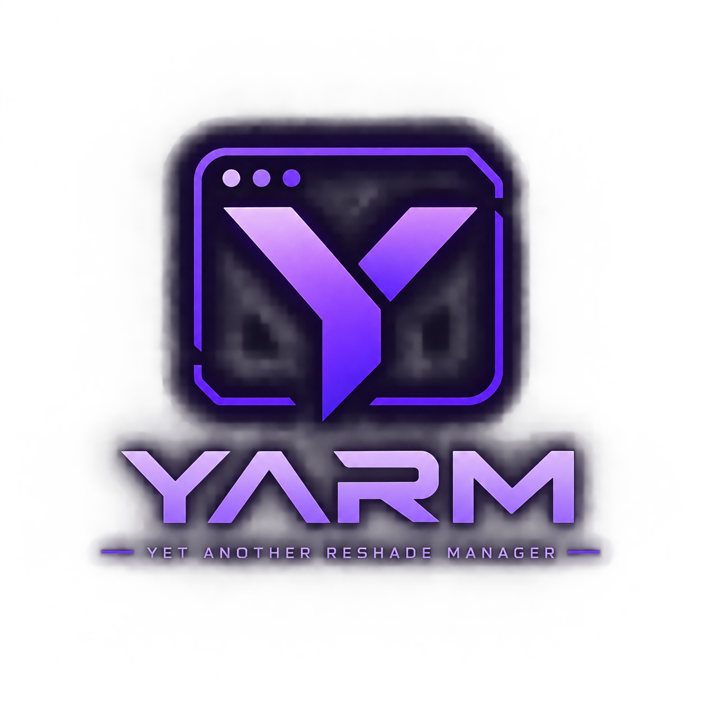
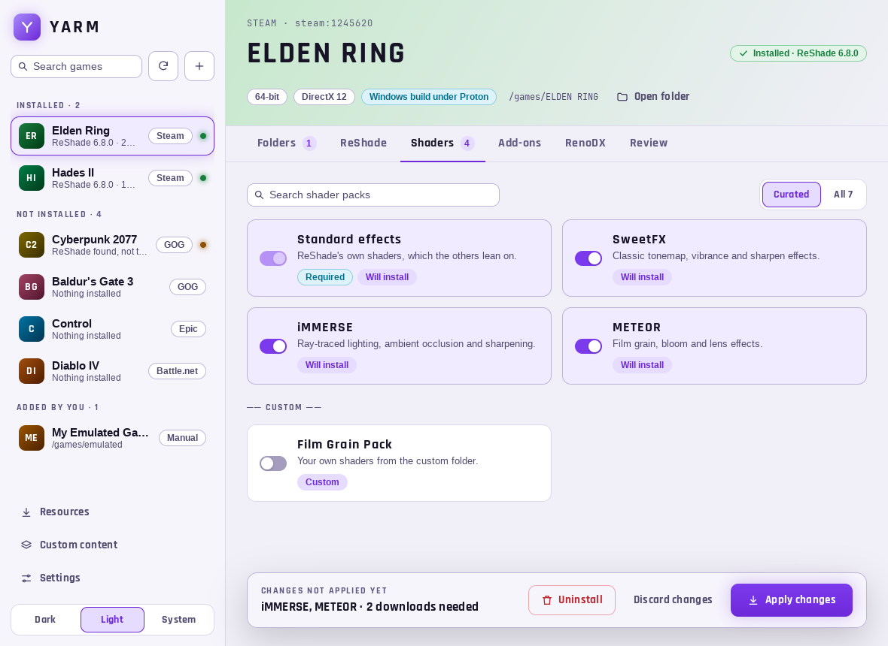

<div align="center">



# Yet Another ReShade Manager

[](https://github.com/secato/yarm/actions/workflows/ci.yml)
[](https://github.com/secato/yarm/releases)
[](LICENSE)

</div>

**Put ReShade into your games, and take it back out.**

Pick a game, choose the ReShade version, shader packs and add-ons you want, and see what will
happen before it does. YARM writes it into the game folder, remembers every file it put there,
and uninstalling gives the folder back exactly as it was.


It finds your Steam, GOG, Epic and Battle.net games (the last three through Heroic and Lutris),
picks the right ReShade build and proxy DLL from the game's executable, and offers the RenoDX
HDR mod for your game by name. It follows your desktop's dark or light setting, and the Omarchy
theme; the Dark / Light / System switch at the bottom of the sidebar picks one
(`YARM_THEME=dark` or `light` forces it).

<details><summary>Light look</summary>



</details>

## Install

```sh
curl -fsSL https://raw.githubusercontent.com/secato/yarm/main/install.sh | sh
```

Downloads the latest release for your CPU (x86_64 or arm64), checks its checksum, and adds YARM
to your application menu. Run it again to update. `./install.sh --uninstall` removes it. More in
[docs/install.md](docs/install.md).

## Build it yourself

```sh
go build -o yarm ./cmd/yarm
./yarm
```

Needs Go 1.27+ and Linux (glibc), x86_64 or arm64. Steam Deck works in Desktop Mode.

## What it does for you

- **Plans before it writes.** The Review tab lists what will be downloaded, written, replaced
  and kept, including a foreign file already holding ReShade's DLL name.
- **Uninstalls cleanly.** Removes only the files it wrote, only if they are unchanged, and
  restores what it replaced.
- **Curated shaders.** Opens on the packs people use (SweetFX, iMMERSE, METEOR, …) with the
  whole catalog one click away; ticking an add-on also ticks the shaders it needs, and says why.
- **Downloads once.** A shared cache, so the fifth game copies instead of downloading again.
- **Adopts** a ReShade you installed by hand, so YARM can update or remove it.
- **Your own content.** Shaders and add-ons you drop in the `custom/` folder show up beside the
  catalog, marked Custom: `~/.local/share/yarm/custom/{shaders,addons}/<name>/`.

Nothing is written to a game folder until you press Install or Apply changes. Ctrl+R rescans,
Ctrl+N adds a game, `/` searches, Ctrl+Enter applies.

MIT licensed. Built with [MyGo](https://github.com/egoist/mygo) and, mostly, with
[Claude Code](https://claude.com/claude-code): [report what breaks](https://github.com/secato/yarm/issues).
Working on it with an AI agent? Start at [CLAUDE.md](CLAUDE.md). How it works:
[docs/architecture](docs/architecture/README.md). Decisions: [docs/SPEC.md](docs/SPEC.md).

Credits: [ReShade](https://reshade.me/) by crosire; catalogs from
[reshade-shaders](https://github.com/crosire/reshade-shaders); inspired by
[LeShade](https://github.com/Ishidawg/LeShade) and
[reshade-steam-proton](https://github.com/kevinlekiller/reshade-steam-proton).
